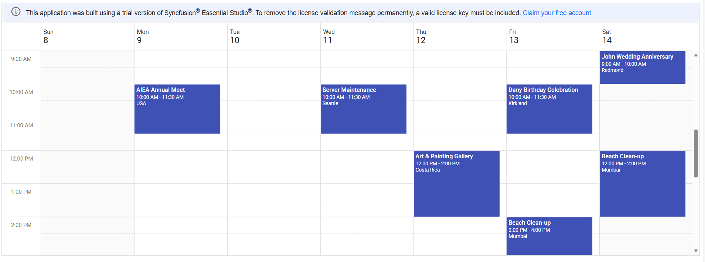

<!--
  howto.md
  A step-by-step guide to integrate EJ2 Angular Scheduler with CRUD using GraphQl Adaptor.
-->
# How to integrate EJ2 Angular Scheduler with CRUD using GraphQl Adaptor.

This repository contains a sample full-stack application demonstrating how to show events in Syncfusion Angular Scheduler component using GraphQl. The Angular frontend provides a responsive UI for viewing and managing calendar events.


## Prerequisites
- Node.js (>= 20.19)
- npm (>= 7.0)
- Angular CLI (= 17)
- Basic familiarity with Angular and GraphQl Adaptor

## Project Structure
```
├── README.md                           # This guide
├── GraphQl                             # Adaptor
│   ├── build    
│   │    ├── index.js    
│   │    ├── index.map  
│   ├── src
│   │    ├── db.js                      # Scheduler Events Data
│   │    ├── resolver.js                # GraphQl Query       
│   │    ├── schema.graphql             # Defines the GraphQL schema
│   ├── package.json                     
├── Schedule                             # Frontend
│    ├── src
│    │    ├── app                        # Contains Angular components, modules , services and routing
│    │    │    ├── app-routing-module.ts
│    │    │    ├── app.component.html    # define Scheduler Component
│    │    │    ├── app.component.scss
│    │    │    ├── app.component.spec.ts
│    │    │    ├── app.component.ts
│    │    │    ├── app.module.ts
│    ├── environments
│    │    ├── environment.prod.ts
│    │    ├── environment.ts       
│    ├── index.html                    # Main HTML Page for load Angular Scheduler
│    ├── main.ts                      
│    ├── polyfills.ts
│    ├── styles.scss
│    ├── test.ts
│    ├── angular.json
│    ├── package.json
├─────── tsconfig.json


```
## Setup

### Cloning the repository
    
- Clone the repository to your local machine

### GraphQL Server setup

### Installation
1. Open a terminal and navigate to the GraphQl folder
    ```bash
    cd GraphQl
    ```
2. Install dependencies
    ```bash
    npm install
    ```
3. Open `GraphQl` folder in terminal and run 

    ```bash
    npm run dev
    ```


### Frontend Setup

### Start Syncfusion Angular Scheduler 

1. Open a terminal and navigate to the Schedule folder
    ```bash
    cd Schedule
    ```
2. Install the required packages
    ```bash
    npm install
    ```
3. Then Run 
    ```bash
    npm start
    ```

## Running the Application
1. Navigate to GraphQl folder
      ```bash
    cd GraphQl
    ```
2. Start the GraphQl server:
    ```bash
    npm run dev
    ```
3. Server started running on `http://localhost:4400`
4. Navigate to Schedule folder
      ```bash
    cd Schedule
    ```
5. Start the Schedule Frontend:
    ```bash
    npm start
    ```
6. Navigate to [`http://localhost:4200`](http://localhost:4200) in your browser.

7. You can perform CRUD operation on the events that will be reflected in the Scheduler.

## Output Preview

*Image illustrating the Syncfusion Angular Scheduler*

## Troubleshooting
- **npm install stuck or fails**: Delete node_modules + package-lock.json, restart system, and reinstall using npm install.
- **Karma/Jasmine version errors**: Install matched versions: karma@6.4.0, karma-jasmine@5.1.0, jasmine-core@5.1.0.

<br/>
<br/>
<br/>

## A step by step guide integrate Syncfusion Angular Scheduler with GraphQl Adaptor.

### Frontend Setup

1. Create a Syncfusion Angular Scheduler by following this [getting started](https://ej2.syncfusion.com/angular/documentation/schedule/getting-started).

    To set up your Angular applications by run the following Command
    ```bash
    npm install -g @angular/cli
    ```
2. Create a Angular app by following command
    ```bash
    ng new my-app
    ```
3. Install the Required Packages in frontend by following commands
    ```bash

       Dependencies:

        npm install @angular/animations
        npm install @angular/common
        npm install @angular/compiler
        npm install @angular/core
        npm install @angular/forms
        npm install @angular/platform-browser
        npm install @angular/platform-browser-dynamic
        npm install @angular/router
        npm install @syncfusion/ej2-angular-buttons
        npm install @syncfusion/ej2-angular-dropdowns
        npm install @syncfusion/ej2-angular-schedule
        npm install rxjs
        npm install tslib
        npm install zone.js

       Dev Dependencies:

        npm install -D @angular-devkit/build-angular
        npm install -D @angular/cli
        npm install -D @angular/compiler-cli
        npm install -D @types/jasmine
        npm install -D @types/node
        npm install -D jasmine-core@5.1.0
        npm install -D karma
        npm install -D karma-chrome-launcher
        npm install -D karma-coverage
        npm install -D karma-jasmine
        npm install -D karma-jasmine-html-reporter

    ```
4. Replace a `app.html` file in `app` folder to define the Scheduler Component
    ```bash
        <ejs-schedule #scheduleObj width="100%" height="550px"     [(selectedDate)]="selectedDate" [eventSettings]="eventSettings">
        </ejs-schedule>
    ```


       
5. Replace this code in `app.ts` file in `app` folder
    ```bash
        import { Component, ViewChild } from '@angular/core';
        import { DataManager, GraphQLAdaptor } from '@syncfusion/ej2-data';
        import { ScheduleModule,DayService, WeekService, WorkWeekService, MonthService, AgendaService, ScheduleComponent, EventSettingsModel } from '@syncfusion/ej2-angular-schedule';

        @Component({
          selector: 'app-root',
          templateUrl: './app.html',
          imports:[ScheduleModule],
          providers: [ScheduleModule, DayService, WeekService, WorkWeekService, MonthService, AgendaService]
        })
        export class AppComponent {
          @ViewChild('scheduleObj') scheduleObj!: ScheduleComponent;
          public dataSource!: DataManager;
          public eventSettings!: EventSettingsModel;
          title!: string;
          ngOnInit(): void {
            this.dataSource = new DataManager({
              url: 'http://localhost:4400/',
              adaptor: new GraphQLAdaptor({
                response: {
                    result: 'getEvents.result',
                },
                query:`query getEvents($datamanager: DataManager) {
                  getEvents(datamanager: $datamanager) {
                      result { Id, Subject, StartTime, EndTime, Location, IsAllDay, RecurrenceRule, StartTimezone, EndTimezone }
                  }
                }`,
                getMutation: function (action: any): string {
                  if (action === 'batch') {
                    return `mutation BatchUpdate($added: [AppointmentFields], $changed: [AppointmentFields], $deleted: [AppointmentFields]){
                      batchUpdate(added: $added, changed: $changed, deleted: $deleted) {
                        Id, Subject, StartTime, EndTime, Location, IsAllDay, RecurrenceRule, StartTimezone, EndTimezone
                      }
                    }`;
                  }
                  return '';

                }
              })
            });
            this.eventSettings = { dataSource: this.dataSource };
          }
          public selectedDate: Date = new Date(2026, 1, 11);
        }
    ```
6. Replace this code in `styles.css` in `src` folder

    ```bash
        
        @import '../node_modules/@syncfusion/ej2-base/styles/material.css';
        @import '../node_modules/@syncfusion/ej2-buttons/styles/material.css';
        @import '../node_modules/@syncfusion/ej2-calendars/styles/material.css';
        @import '../node_modules/@syncfusion/ej2-dropdowns/styles/material.css';
        @import '../node_modules/@syncfusion/ej2-inputs/styles/material.css';
        @import '../node_modules/@syncfusion/ej2-lists/styles/material.css';
        @import '../node_modules/@syncfusion/ej2-popups/styles/material.css';
        @import '../node_modules/@syncfusion/ej2-navigations/styles/material.css';
        @import '../node_modules/@syncfusion/ej2-angular-schedule/styles/material.css';
    ```

7. Replace `App` as `AppAppComponent` in `main.ts` file in `src` folder
    ```bash

        import { bootstrapApplication } from '@angular/platform-browser';
        import { appConfig } from './app/app.config';
        import { AppComponent } from './app/app';

        bootstrapApplication(AppComponent, appConfig)
          .catch((err) => console.error(err));

    ```
### GraphQl Setup

1. Create a `GraphQl` folder and navigate to that
2. Install the Required Packages in GraphQl by following commands
    ```bash
        npm install graphpack
        npm install @syncfusion/ej2-data
    ```
    Add this lines after in package.json to defines commands with npm

    ```bash
        "scripts": {
              "dev": "graphpack --port 4400",
              "build": "graphpack build"
            }
    ```
3. Create a `src` folder inside `GraphQl`
4. Create a `db.js` inside `src` folder to store the Scheduler events. for example:
    ```bash
        
        export let eventsData = [
          {
            Id: 1,
            Subject: 'Server Maintenance',
            StartTime: new Date(2026, 1, 11, 10, 0).toISOString(),
            EndTime: new Date(2026, 1, 11, 11, 30).toISOString(),
            Location: 'Seattle'
          }, {
            Id: 2,
            Subject: 'Art & Painting Gallery',
            StartTime: new Date(2026, 1, 12, 12, 0).toISOString(),
            EndTime: new Date(2026, 1, 12, 14, 0).toISOString(),
            Location: 'Costa Rica'
          }, {
            Id: 3,
            Subject: 'Dany Birthday Celebration',
            StartTime: new Date(2026, 1, 13, 10, 0).toISOString(),
            EndTime: new Date(2026, 1, 13, 11, 30).toISOString(),
            Location: 'Kirkland'
          }, {
            Id: 4,
            Subject: 'John Wedding Anniversary',
            StartTime: new Date(2026, 1, 14, 9, 0).toISOString(),
            EndTime: new Date(2026, 1, 14, 10, 0).toISOString(),
            Location: 'Redmond'
          }, {
            Id: 5,
            Subject: 'ISA Annual Conference',
            StartTime: new Date(2026, 1, 15, 10, 0).toISOString(),
            EndTime: new Date(2026, 1, 15, 11, 30).toISOString(),
            Location: 'USA'
          }, {
            Id: 6,
            Subject: 'Equipment Maintenance',
            StartTime: new Date(2026, 1, 16, 12, 0).toISOString(),
            EndTime: new Date(2026, 1, 16, 14, 0).toISOString(),
            Location: 'Seattle',
          }, {
            Id: 7,
            Subject: 'Aircraft Maintenance',
            StartTime: new Date(2026, 1, 17, 10, 0).toISOString(),
            EndTime: new Date(2026, 1, 17, 11, 30).toISOString(),
            Location: 'Seattle'
          }, {
            Id: 8,
            Subject: 'Facilities Maintenance',
            StartTime: new Date(2026, 1, 19, 9, 30).toISOString(),
            EndTime: new Date(2026, 1, 19, 11, 0).toISOString(),
            Location: 'Seattle'
          }, {
            Id: 9,
            Subject: 'Britto Birthday Celebration',
            StartTime: new Date(2026, 1, 21, 11, 0).toISOString(),
            EndTime: new Date(2026, 1, 21, 13, 0).toISOString(),
            Location: 'Greenland'
          }, {
            Id: 10,
            Subject: 'Justin Wedding Anniversary',
            StartTime: new Date(2026, 1, 22, 9, 30).toISOString(),
            EndTime: new Date(2026, 1, 22, 11, 0).toISOString(),
            Location: 'Finland'
          }, {
            Id: 11,
            Subject: 'AIEA Annual Meet',
            StartTime: new Date(2026, 1, 9, 10, 0).toISOString(),
            EndTime: new Date(2026, 1, 9, 11, 30).toISOString(),
            Location: 'USA'
          }, {
            Id: 12,
            Subject: 'AAN Conference',
            StartTime: new Date(2026, 1, 7, 10, 30).toISOString(),
            EndTime: new Date(2026, 1, 7, 12, 30).toISOString(),
            Location: 'USA'
          }, {
            Id: 13,
            Subject: 'Photography Gallery',
            StartTime: new Date(2026, 1, 5, 10, 0).toISOString(),
            EndTime: new Date(2026, 1, 5, 11, 30).toISOString(),
            Location: 'Chennai'
          }, {
            Id: 14,
            Subject: 'Beach Clean-up',
            StartTime: new Date(2026, 1, 14, 12, 0).toISOString(),
            EndTime: new Date(2026, 1, 14, 14, 0).toISOString(),
            Location: 'Mumbai'
          }, {
            Id: 15,
            Subject: 'Turtle Walk',
            StartTime: new Date(2026, 1, 19, 13, 0).toISOString(),
            EndTime: new Date(2026, 1, 19, 14, 30).toISOString(),
            Location: 'Costa Rica'
          }, {
            Id: 16,
            Subject: 'Silent Walk for Cancer day',
            StartTime: new Date(2026, 1, 22, 13, 0).toISOString(),
            EndTime: new Date(2026, 1, 22, 14, 30).toISOString(),
            Location: 'Chennai'
          }, {
            Id: 17,
            Subject: 'Beach Clean-up',
            StartTime: new Date(2026, 1, 13, 14, 0).toISOString(),
            EndTime: new Date(2026, 1, 13, 16, 0).toISOString(),
            Location: 'Mumbai'
          }, {
            Id: 18,
            Subject: 'Photography Gallery',
            StartTime: new Date(2026, 1, 15, 14, 0).toISOString(),
            EndTime: new Date(2026, 1, 15, 16, 0).toISOString(),
            Location: 'Chennai'
          }
        ];
    ```
5. Create a `resolver.js` inside `src` folder to handle GraphQl Query
    ```bash
        import { eventsData } from "./db";
        function sameId(a, b) {
          if (a === undefined || a === null || b === undefined || b === null) return false;
          return String(a) === String(b);
        }
        const resolvers = {
          Query: {
            getEvents: (parent, datamanager, context, info) => { 
              const dataArgs = datamanager;
              const params = JSON.parse(dataArgs.datamanager.params);
              console.log('startDate: ' + params.StartDate + ' EndDate: ' + params.EndDate);
              var data = eventsData.filter(x => new Date(x.StartTime) >= new Date(params.StartDate) && new Date(x.EndTime) <= new Date(params.EndDate));
              return {result: data || eventsData};
            }
          },
          Mutation: {
            batchUpdate: (parent, { added, changed, deleted }, context, info) => {
              if (added && added.length > 0) {
                console.log('added: ' + added.length);
                added.forEach((order) => {
                  let existingIndex = -1;
                  for (let i = 0; i < eventsData.length; i++) {
                    if (sameId(eventsData[i].Id, order && order.Id)) {
                      existingIndex = i;
                      break;
                    }
                  }
                  if (existingIndex >= 0) {
                    const target = eventsData[existingIndex];
                    if ('Id' in order) target.Id = order.Id;
                    if ('Subject' in order) target.Subject = order.Subject;
                    if ('StartTime' in order) target.StartTime = order.StartTime;
                    if ('EndTime' in order) target.EndTime = order.EndTime;
                    if ('Location' in order) target.Location = order.Location;
                    if ('IsAllDay' in order) target.IsAllDay = order.IsAllDay;
                    if ('RecurrenceRule' in order) target.RecurrenceRule = order.RecurrenceRule;
                    if ('StartTimezone' in order) target.StartTimezone = order.StartTimezone;
                    if ('EndTimezone' in order) target.EndTimezone = order.EndTimezone;
                  } else {
                    eventsData.push(order);
                  }
                });
              }
              if (changed && changed.length > 0) {
                console.log('changed: ' + changed.length);
                changed.forEach((order) => {
                  let target = null;
                  for (let i = 0; i < eventsData.length; i++) {
                    if (sameId(eventsData[i].Id, order && order.Id)) {
                      target = eventsData[i];
                      break;
                    }
                  }
                  if (!target) {
                    console.log('Change skipped: app not found for Id:', order && order.Id);
                    return;
                  }
                  if ('Id' in order) target.Id = order.Id;
                  if ('Subject' in order) target.Subject = order.Subject;
                  if ('StartTime' in order) target.StartTime = order.StartTime;
                  if ('EndTime' in order) target.EndTime = order.EndTime;
                  if ('Location' in order) target.Location = order.Location;
                  if ('IsAllDay' in order) target.IsAllDay = order.IsAllDay;
                  if ('RecurrenceRule' in order) target.RecurrenceRule = order.RecurrenceRule;
                  if ('StartTimezone' in order) target.StartTimezone = order.StartTimezone;
                  if ('EndTimezone' in order) target.EndTimezone = order.EndTimezone;
                });
              }
              if (deleted && deleted.length > 0) {
                console.log('deleted: ' + deleted.length);
                deleted.forEach((order) => {
                  const eventID = (order && typeof order === 'object') ? order.Id : order;
                  let idx = -1;
                  for (let i = 0; i < eventsData.length; i++) {
                    if (sameId(eventsData[i].Id, eventID)) {
                      idx = i;
                      break;
                    }
                  }
                  if (idx === -1) {
                    console.log("Delete skipped: app not found.", eventID);
                    return;
                  }
                  eventsData.splice(idx, 1);
                });
              }
            }
          }
        };
        export default resolvers;
    ```
6. Create a `schema.graphql` inside `src` folder to define GraphQl Schema
    ```bash
        input Sort {
            name: String!
            direction: String!
        }

        input Aggregate {
            field: String!
            type: String!
        }

        #Syncfusion DataManager query params

        input DataManager {
            skip: Int
            take: Int
            sorted: [Sort]
            group: [String]
            table: String
            select: [String]
            where: String
            search: String
            requiresCounts: Boolean
            aggregates: [Aggregate]
            params: String
        }

        # Schedule Appointment field names
        input AppointmentFields {
          Id: Int!
          Subject: String
          StartTime: String!
          EndTime: String!
          Location: String
          IsAllDay: Boolean
          Guid: String
          RecurrenceRule: String
          StartTimezone: String
          EndTimezone: String
        }

        type Appointment {
          Id: Int!
          Subject: String
          StartTime: String!
          EndTime: String!
          Location: String
          IsAllDay: Boolean
          RecurrenceRule: String
          StartTimezone: String
          EndTimezone: String
        }

        type ReturnType {
          result: [Appointment]
        }

        type Query {
          getEvents(datamanager: DataManager): ReturnType 
        }

        type Mutation {
          batchUpdate(added: [AppointmentFields], changed: [AppointmentFields],         deleted: [AppointmentFields]): Appointment
        }
    ```
### Running the Application
1. Navigate to GraphQl folder
      ```bash
    cd GraphQl
    ```
2. Start the GraphQl server:
    ```bash
    npm run dev
    ```
3. Server started running on `http://localhost:4400` or you can change the port no
4. Navigate to Schedule folder
      ```bash
    cd Schedule
    ```
5. Start the Schedule Frontend:
    ```bash
    npm start
    ```
6. Navigate to [`http://localhost:4200`](http://localhost:4200) in your browser or you can change the port no.

7. You can perform CRUD operation on the events that will be reflected in the Scheduler.